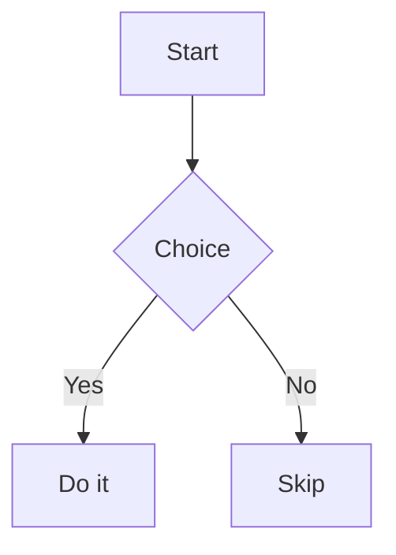

# Crawling Documentation Portal

A single-file documentation portal for game projects. Your docs are plain Markdown files that live in your Git repo, and the portal gives your team a fast, searchable way to read and organise them, from the Unity Editor or straight from the repo.

- **Three sections:** Design, Art and Scripting
- **Pages can have child pages**, so docs form a tree
- **Add, rename, delete and reorganise** pages with drag and drop, no manual file shuffling
- **Page templates** for new files
- **Rich Markdown:** HTML, LaTeX maths, Mermaid diagrams and Excel-style sheets with live formulas
- **Open any page in your IDE** with one key
- **Lazy and light:** pages are fetched only when opened, and search indexes on first use

```
Crawling_Documentation_Portal/
├── crawling_documentation_portal.html   the portal itself (one file)
├── UNITY/
│   ├── package.json                     UPM package configuration
│   ├── DocsPortalMenu.cs                Unity Editor menu (Tools > Docs)
│   └── DocsPortal.asmdef                Editor-only assembly definition
└── LICENSE
```

---

## Requirements

| What | Why |
| --- | --- |
| **Chrome or Edge** | The portal reads and writes your docs folder through the browser's File System Access API, which only Chromium browsers provide. Firefox and Safari cannot open the folder, so the portal can't load your docs there. |
| **Unity** (optional) | Only for the `Tools > Docs` menu. The portal also works on its own, without Unity. |
| **An editor with a URL handler** (optional) | For the `F4` "open in IDE" shortcut: VS Code, VS Code Insiders, Cursor or VSCodium, or any editor via a custom URL. |

---

## Setup (Unity)

### 1. Install the package

In Unity, open **Window > Package Manager**. Click the **+** icon in the top-left corner, select **Add package from git URL...**, and paste the following URL:

`https://github.com/CrawlingWharf90/Crawling_Documentation_Portal.git?path=/UNITY#v1.0.0`

*(Note: Change `#v1.0.0` to the latest release tag).*

### 2. Initialize the docs folder

In Unity choose **Tools > Docs > Create Docs Folder**. This:

1. creates a `Docs~` folder next to `Assets/` (in the project root),
2. creates `Docs~/Resources/Markdown/new_file.md`, an empty page template,
3. copies `crawling_documentation_portal.html` from the installed package into `Docs~`.

> `Docs~` ends with a `~`, so Unity ignores it and never generates `.meta` files for your docs. Git still tracks it normally.

### 3. Open the docs

Choose **Tools > Docs > Open Documentation**. On Windows this opens the portal in Chrome or Edge if one is installed.

### 4. Connect the folder (once per machine)

The first time, the portal shows **Connect docs folder**.

1. Click the button. The portal copies its own folder path to your clipboard.
2. In the folder dialog, click the **Folder** box, press `Ctrl+V`, then `Enter`, then **Select Folder**. (macOS: press `Cmd+Shift+G` and paste.)
3. Allow the browser to edit files in that folder when it asks.

The browser remembers the folder. After a browser restart it may ask you to re-allow access: click **Reconnect folder**.

### 5. Name the project and choose a mode

On the very first start of a new docs folder, a setup dialog asks for:

- **Project name.** It is shown in the sidebar and tab title and is saved in `_manifest.json`, so the whole team sees it. You can rename it later (see below).
- **Mode.** This is fixed once created. Delete `_manifest.json` to start over.

| Mode | How files are stored | Best for |
| --- | --- | --- |
| **Folders** | The hierarchy mirrors directories: `Design/`, `Art/`, `Scripting/`. A page's children live in a folder named after it (`Combat.md` has children in `Combat/Melee.md`). Siblings share a folder and are sorted alphabetically (use number prefixes such as `01_Intro.md` to control order). | Teams who want the Git folder structure to match the docs tree. |
| **Single folder** | Every file lives in one `pages/` folder. The hierarchy and the order are stored in `_manifest.json`. | Teams who want exact manual ordering and a flat file list. |

In both modes a page can have child pages.

### 6. Commit it

Commit the whole `Docs~` folder, **including `_manifest.json`**. Teammates then pull, open **Tools > Docs > Open Documentation**, and connect the folder once on their machine.

### Updating the portal

Update the package version via the Unity Package Manager by changing the Git URL tag to the latest version. Then, run **Tools > Docs > Create Docs Folder** again and choose **Replace**. This copies the newest portal into your project. Your pages and `_manifest.json` are never touched.

### Setup without Unity

Create a docs folder anywhere, copy `crawling_documentation_portal.html` into it, open the file in Chrome or Edge, and follow steps 4 and 5 above. To let browsers without folder access read the docs, serve the folder over HTTP (for example `python -m http.server` inside it). That is read-only.

---

## Using the portal

### Browsing

- The tree on the left shows **Design**, **Art** and **Scripting**. Click a page to open it, and click the arrow next to a page to show its children.
- The **Expand/Collapse** link under the search box opens or closes the whole tree.
- Every page has its own address (`...#Design/Combat.md`), so you can bookmark it or share the link.
- Links between pages work: `[see combat](Combat.md)` in a page opens that page.
- Link to a section with `[text](Combat.md#melee-attacks)`, or inside the same page with `[text](#melee-attacks)`. The section name is the heading in lowercase, with spaces replaced by hyphens and punctuation removed (`## Melee Attacks` becomes `#melee-attacks`). Repeated headings get `-1`, `-2`, and so on.
- Click the project name at the top of the sidebar to return to the home page.

### Searching

Press `/` to jump to the search box. The first search indexes every page (a progress counter shows in the sidebar), after which results are instant. All words you type must appear in a page, and title matches rank first. Click a result to open it.

### Adding pages

Click **Add docs**. A menu offers two options.

**Upload Local File** copies one or more existing `.md` files into the docs folder. (You can also drag `.md` files from your file explorer onto the window.)

**New File** creates a page from a template (see [Templates](#templates)). The portal asks for a name, and that name becomes the file name and, in Single folder mode, the page title.

After picking the file(s), choose the section and where it goes:

- **Top level:** no parent, listed directly under the section.
- **Sub level:** opens a placement window. Drag the highlighted page onto another page: drop in the **middle** to make it a **child**, or on the **top/bottom edge** to make it a **sibling**. A section bar at the top of each group places it at the top level. Press **Add here** to finish.

The portal refreshes itself afterwards. The portal **copies** uploaded files, so edit the copy that now lives in the docs folder, not your original.

### Templates

Templates are the `.md` files in `Docs~/Resources/Markdown/`.

- **One template:** **New File** uses it automatically.
- **More than one:** a window asks which template to use.
- `{{title}}` inside a template is replaced by the name you type.
- Create templates from Unity with **Tools > Docs > Create Docs File Template**. It asks for a name, creates an empty `.md` in `Resources/Markdown`, and opens it in your IDE so you can write the template.

### Editing a page

Open the page and press `F4` to edit its `.md` file in your IDE. The first time, pick your editor (change it later in **menu > Editor settings**). Save, then switch back to the browser, and the page reloads by itself.

| Editor | Notes |
| --- | --- |
| VS Code, VS Code Insiders, Cursor, VSCodium | Built in. The editor must be installed. Your browser may ask permission to open it the first time. |
| Anything else | Choose **Other (custom URL)** and enter a template such as `myeditor://open?file={enc}`. `{path}` is the plain path, `{enc}` is the URL-encoded path. |

If you open the portal over HTTP instead of from the Unity menu, it will ask once for the absolute path of the docs folder.

### Renaming

- **A page:** open it and press `F2`.
  - Single folder mode changes the title shown in the tree.
  - Folders mode renames the file on disk, together with its children folder and images. Keep a number prefix if you use one for ordering. Links to the page from other pages are not updated.
- **The project:** click the project name at the top of the sidebar (or open the home page) and press `F2`. Double-clicking the name also works.

### Deleting

Open a page and press `Del`. You always get a confirmation. If the page has children you choose to **keep them** (they move up one level) or **delete them too**. In Folders mode, images stored beside the page are deleted with it.

### Reorganising

Open the menu at the bottom of the sidebar and choose **Reorganize**. This opens the same drag-and-drop window as adding a page, with every page movable. Press **Apply** to save.

- Single folder mode stores the new order in the manifest.
- Folders mode moves the files on disk. Siblings stay alphabetical, and relative links inside moved pages are not rewritten.

### Refreshing

Menu > **Refresh** re-reads the docs folder. Use it after a `git pull` or after changing files outside the portal.

### Keyboard shortcuts

| Key | Action |
| --- | --- |
| `/` | Search |
| `F2` | Rename the open page (or the project, from the home page or the project name) |
| `F4` | Open the page in your IDE |
| `Del` | Delete the open page |
| `Esc` | Close menus and windows |

Shortcuts act on the page that is currently open.

### The Unity menu

| Item | What it does |
| --- | --- |
| **Tools > Docs > Open Documentation** | Opens the portal in the browser. |
| **Tools > Docs > Reveal Docs Folder** | Shows the portal file in your file explorer. |
| **Tools > Docs > Create Docs Folder** | Creates `Docs~`, the template folder, and copies the portal from the package. |
| **Tools > Docs > Create Docs File Template** | Creates a new page template and opens it in your IDE. |

---

## Writing pages

Pages are standard Markdown with a few extras.

**Basics:** headings, bold, italic, links, images, quotes, bullet and numbered lists, tables, horizontal rules, fenced code blocks (with a Copy button) and task-list items. Images use paths relative to the page, for example ``.

### HTML

HTML works inside pages: tables, `<details>`, ``, `<kbd>`, `<br>`, colours via `style`, and more. Unsafe content is removed: `<script>`, event handlers, `javascript:` links and `url()` styles. Markdown is not parsed inside an HTML block.

A `<style>` block works too, but it only affects the page it is written in. `body`, `html` and `:root` mean that page's content area:

```html
<style>
  body { color: #ddd; }
  h1 { color: orange; }
</style>
```

**Custom tags** such as `<dialogue-container>` or `<dialogue>` are kept as elements. A tag counts as custom if its name contains a hyphen, or if the page also closes it (`</dialogue>`), so text like `List<int>` stays plain text. Custom tags written on their own line are block elements, markdown inside them still renders, and you can style them with a `<style>` block (for example `dialogue { display: flex; }`). Event attributes such as `onclick` and `id` are removed.

A line that ends with two spaces or a backslash becomes a line break.

### Maths (LaTeX)

Write `$E = mc^2$` for inline maths and `$$ ... $$` for a block:

```
$$
\sum_{i=1}^{n} i = \frac{n(n+1)}{2}
$$
```

A lone price such as `$5` is left alone. Write `\$` for a literal dollar sign when another `$` follows on the same line.

### Diagrams (Mermaid)

Use a code block whose language is `mermaid`:

````

````

### Spreadsheets with formulas

Use a code block whose language is `sheet`. Put `header` after it to style the first row as a header. You can paste straight from Excel (tab-separated) or write rows with `|` or commas. Cells starting with `=` are formulas that recalculate live.

````
```sheet header
Item,Qty,Price,Total
Sword,3,12.5,=B2*C2
Shield,2,20,=B3*C3
Sum,,,=SUM(D2:D3)
```
````

- **Operators:** `+ - * / ^ %`, `&` for text, and comparisons (`= <> < > <= >=`), with Excel precedence.
- **References:** cells like `B2` and ranges like `B2:B9`.
- **Functions:** SUM, AVERAGE, MIN, MAX, COUNT, PRODUCT, ROUND, FLOOR, CEIL, ABS, SQRT, POW, MOD, LOG, LN, EXP, IF, AND, OR, NOT.
- Errors such as `#DIV/0!`, `#NAME?` and `#CYCLE!` show in red, and hovering a result shows its formula.
- Limits: formulas work within one sheet block (no cross-sheet references), and there are no charts.

### Other limits

Nested lists are shown flat, and there is no syntax highlighting inside code blocks.

---

## Offline use and external libraries

Maths and diagrams need two libraries. They are loaded from the jsDelivr CDN **only when a page uses them**:

| Feature | Library | Local copy (used first if present) |
| --- | --- | --- |
| LaTeX maths | KaTeX 0.16.11 | `Docs~/_vendor/katex/` containing `katex.min.js`, `katex.min.css` and its `fonts/` folder |
| Mermaid diagrams | Mermaid 11.4.1 | `Docs~/_vendor/mermaid/mermaid.min.js` |

If a library can't be loaded, the page shows the raw source instead and the rest still works.

---

## Troubleshooting

| Problem | Fix |
| --- | --- |
| The portal only shows "Connect docs folder" | Click it and select the folder that contains the portal file (see setup step 4). After a browser restart choose **Reconnect folder**. |
| "Editing docs needs Chrome or Edge" | Open the portal in Chrome or Edge. |
| Pages are missing after you edited files outside the portal | Menu > **Refresh**. |
| A **Folders** mode page shows in italics with a folder icon | A directory exists without a page of the same name (for example `Combat/` without `Combat.md`). Add the parent page or ignore it. |
| A move or rename says "Target already exists" | A file with that name is already in the destination. Rename one of them first. |
| `F4` does nothing | Check **menu > Editor settings** and that your editor is installed. Your browser may need to be allowed to open it. |
| Maths or diagrams show as plain text | The library could not load. Check your connection or add a local copy under `_vendor/`. |
| Package Manager cannot find `package.json` | Ensure you included `?path=/UNITY` in the Git URL when installing the package. |

---

## License

See [LICENSE](LICENSE).
